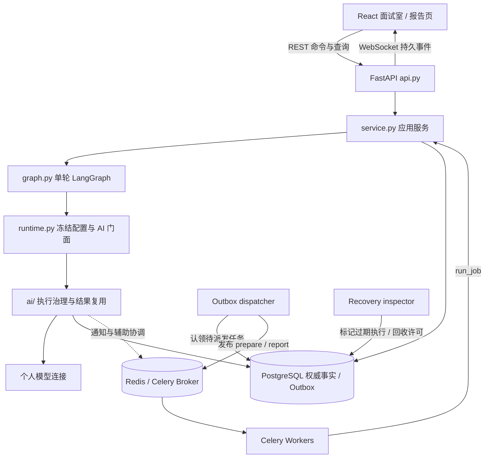
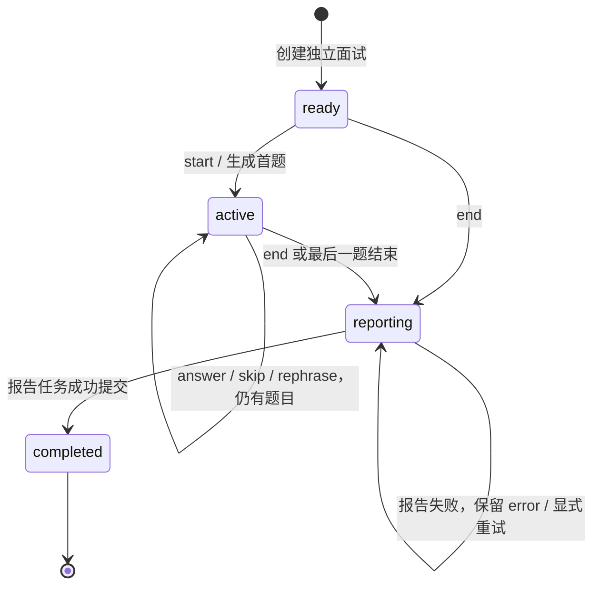
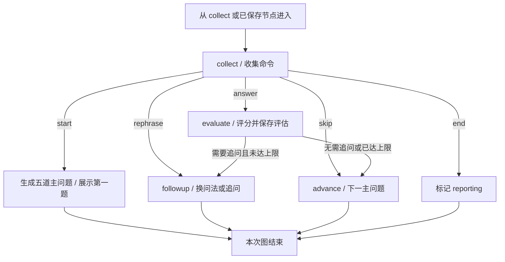
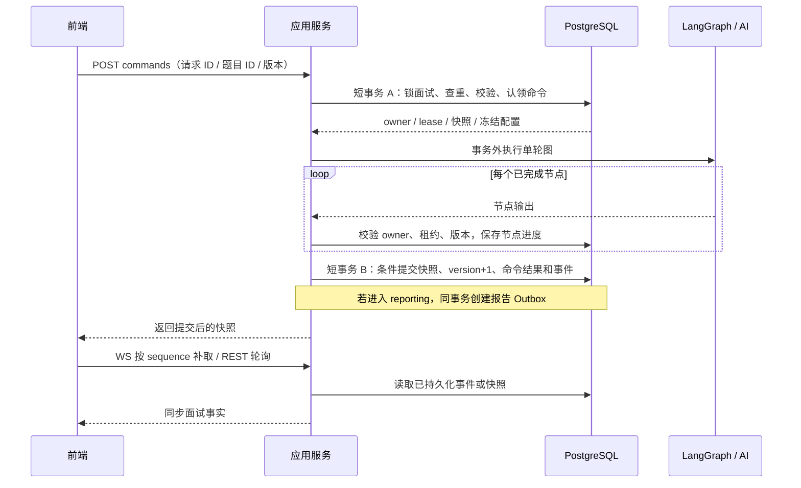

# 模拟面试工程设计

本文按当前工作区实现整理，核对日期为 2026-10-26，描述已经实现的设计。平台整体入口与运行约定以 [platform.md](platform.md) 为准；部署、容量参数和故障操作见 [工程化运行手册](engineering-operations.md)。

## 1. 设计定位

模拟面试是一个由用户命令驱动、可持久恢复的状态机。LangGraph 编排一次操作中的 AI 节点，应用服务负责状态是否合法、谁有权执行、结果能否提交，以及失败后从哪里继续。

核心约束：

- **PostgreSQL 保存面试事实**：题目、回答、评估、报告、命令进度和事件均持久化。Redis 丢失不能改写这些事实。
- **一次命令运行一轮图**：生成当前操作的结果后结束图；等待用户时不占用图执行，也不另建 LangGraph checkpointer。
- **模型调用在数据库事务外执行**：认领和提交使用短事务；提交必须通过 owner、租约和版本校验。
- **恢复读取不调用 AI**：刷新、重连、历史和报告查询只读取已保存内容，允许标记过期执行状态。
- **区分失败与结果未知**：上游超时或连接中断可能已经产生结果、费用；结果未知不自动重发，用户确认后创建新尝试。
- **评分有明确来源**：回答评分来自通过契约校验的模型结果；主动跳过主问题按业务规则记零分；报告汇总不重新评分。

这里的出题官、评分官、提问官和复盘官是不同场景配置与图节点，不是后台持续自主交谈的多个 Agent 进程。

## 2. 总体架构与职责



| 边界 | 职责 | 代码入口 |
| --- | --- | --- |
| 页面与交互 | 简历收集、开始、回答、草稿恢复、报告展示 | [InterviewRoom.tsx](../frontend/src/platform/InterviewRoom.tsx)、[Interview.tsx](../frontend/src/platform/Interview.tsx)、[Report.tsx](../frontend/src/platform/Report.tsx) |
| 状态同步 | 快照合并、事件游标、重连、REST 轮询 | [hooks.ts](../frontend/src/platform/hooks.ts) |
| 传输适配 | 参数校验、身份与归属检查，REST/WS 统一进入应用服务 | [api.py](../backend/app/platform/api.py)、[auth.py](../backend/app/platform/auth.py) |
| 应用与持久化 | 创建面试、认领命令、节点进度、条件提交、异步任务、重试 | [service.py](../backend/app/platform/service.py) |
| 领域规则 | 合法动作、快照格式版本、AI 输出契约 | [domain/state.py](../backend/app/platform/domain/state.py)、[domain/results.py](../backend/app/platform/domain/results.py) |
| 工作流 | 解析、诊断、单轮面试、报告四张图 | [graph.py](../backend/app/platform/graph.py) |
| AI 边界 | 冻结配置、供应商适配、准入、配额、工具、调用账本与结果复用 | [runtime.py](../backend/app/platform/runtime.py)、[ai/](../backend/app/platform/ai/) |
| 异步与恢复 | Outbox 派发、Celery 执行、过期巡检 | [worker.py](../backend/app/platform/worker.py)、[operations/recovery.py](../backend/app/platform/operations/recovery.py) |
| 媒体扩展 | ASR、TTS、摄像头与独立视觉建议 | [media.py](../backend/app/platform/media.py)、[Camera.tsx](../frontend/src/platform/Camera.tsx) |

## 3. 用户流程与创建边界

1. 登录后进入 `/interviews/new`，在面试室上传或选择简历。此时只是准备页面，尚未创建面试记录。
2. 上传接口保存私有文件，并在同一数据库事务中创建 `Resume` 与 `prepare` Outbox 任务。
3. 准备 Worker 提取 PDF/DOCX/TXT 文本、脱敏，再运行 `parsing_graph`，只保存结构化简历事实；成功后简历为 `ready`。
4. 用户点击开始，`POST /api/interviews` 检查简历归属与解析状态，复制简历事实、冻结本次模型配置，创建独立的 `ready` 面试。此时题目列表仍为空。
5. 页面进入 `/interviews/{id}` 后消费一次开始动作，发送 `start` 命令，生成五道主问题并展示第一题。普通刷新只恢复状态。
6. 用户提交回答，系统评分并决定追问或进入下一主问题；也可换问法、跳过或提前结束。
7. 主问题结束或收到 `end` 后，面试进入 `reporting`，事务内创建报告任务。报告 Worker 完成后变为 `completed`。

同一份已解析简历可以创建多次相互独立的面试，每次重新冻结当前配置。简历诊断使用独立的 `ResumeDiagnosis`、`diagnose` 任务与 `resume` 场景，由 `prepare` 队列消费；诊断未做、失败或结果未知都不阻塞面试。新面试与报告不引用简历诊断分数。

## 4. 状态模型

### 4.1 面试状态



| 状态 | 允许的面试命令 | 含义 |
| --- | --- | --- |
| `ready` | `start`、`end` | 已创建，尚未开始出题 |
| `active` | `answer`、`skip`、`rephrase`、`end` | 当前有待回答的问题 |
| `reporting` | 无；另有报告重试接口 | 问答已结束，报告排队、执行或失败待重试 |
| `completed` | 无 | 已保存报告 |
| `failed` | 无 | 领域与数据库保留的状态；当前常规面试失败通过命令状态或 `reporting + error` 表达 |

面试状态与一次执行的状态分开。评分失败不会把整个面试判成结束；报告失败也保留既有问题、回答和评估。

### 4.2 执行状态

| 对象 | 状态字段 | 作用 |
| --- | --- | --- |
| 命令 `Command` | `running / completed / failed / unknown` | 一次用户操作的执行与重放 |
| Outbox 投递 | `pending / published` | 是否已经发布到 Broker |
| Outbox 执行 | `queued / running / completed / failed / unknown` | Worker 是否认领、完成或等待显式重试 |
| 简历解析与独立诊断 | 各自的 `queued / processing / ready / failed` | 互不覆盖任务状态；未知原因保留在关联任务与错误中 |

`published` 不代表执行完成；租约过期也不代表供应商没有执行。

## 5. 单轮 LangGraph 与出题策略



上图表达业务路径。代码中 `start`、`skip`、`end` 在 `collect` 内直接完成；从评分进入下一题时才运行独立的 `advance` 节点。恢复执行可直接从 `evaluate`、`followup`、`advance` 或已完成位置继续。

| 动作 | 当前实现 |
| --- | --- |
| `start` | 题目为空时调用 `questions` 场景，要求恰好五道有效主问题；初始化第一题 |
| `answer` | 记录回答，调用 `evaluate`，严格校验总分与五个维度，再追问或推进 |
| 追问分支 | `(follow_up_needed 或 score < 60) 且 follow_up_count < 2`；每道主问题最多两次追问 |
| `rephrase` | 调用 `followup` 场景，保持当前考点、主问题位置和主问/追问属性，生成新 `question_id`；不评分、不增加追问次数 |
| `skip` | 跳过主问题写入明确的零分评估；跳过追问不追加零分，直接进入下一主问题 |
| `end` | 清空当前问题，进入报告阶段，不给未完成回答补分 |

评分输入包含结构化简历、当前问题、当前回答与最近八条对话。追问输入使用当前问题及最近三条评估。五道主问题在首次开始时一次生成，追问按回答动态生成。

当前题数、60 分追问阈值和两次追问上限写在图逻辑中；创建接口仅接收 `resume_id`，没有岗位、难度、时长或题数配置。

## 6. 持久化模型

| 数据 | 表 | 关键内容 |
| --- | --- | --- |
| 简历事实 | `platform_resumes` | 文件归属、脱敏文本、结构化事实、解析状态与配置 |
| 可选诊断 | `platform_resume_diagnoses` | 独立诊断结果、状态、任务与冻结配置 |
| 面试聚合 | `platform_interviews` | 用户/简历归属、业务状态、`version`、`snapshot`、`config_snapshot`、报告、活动任务 |
| 命令记录 | `platform_commands` | 唯一 `(interview_id, request_id)`、输入摘要、owner、租约、结果或节点进度 |
| 持久事件 | `platform_events` | 唯一 `(interview_id, sequence)`、事件 ID、快照与追踪 ID |
| 异步任务 | `platform_outbox` | 聚合 ID、任务类型、投递/执行状态、投递与执行租约、重试代次 |
| 逻辑结果 | `platform_ai_flights` | 逻辑操作、尝试代次、输入/配置标识、已知结果或未知原因 |
| 物理调用与许可 | `platform_ai_calls`、`platform_ai_permits` | 每次供应商请求的用量/结果状态，以及共享并发许可 |

面试 `snapshot` 保存：

```text
schema_version       快照格式版本，当前为 1
parsed               创建面试时复制的结构化简历事实
questions            本次五道主问题（开始前为空）
messages             已提交的用户与面试官消息
evaluations          主问题/追问的逐轮评估与主动跳过记录
main_index           当前主问题位置
follow_up_count      当前主问题已追问次数
current_question     当前问题 ID、正文、主问题位置与追问标记
status / demo        图内状态与演示来源标记
```

三个版本概念分别负责不同问题：`schema_version` 判断快照能否读取；`Interview.version` 防止并发覆盖；场景、模型与 Agent 版本随 `config_snapshot` 固定本次执行语义。

`Command.result` 在执行中保存原始输入、`checkpoint`、`operation_id`、`generation` 和追踪信息，失败时另存错误契约；成功后保存该命令提交时的响应快照。节点进度可包含尚未提交到面试聚合的回答或评分。

## 7. 命令协议与一致性

### 7.1 接口契约

```json
{
  "request_id": "unique-request-id",
  "type": "answer",
  "expected_question_id": "current-question-id",
  "version": 1,
  "content": "我的回答"
}
```

| 字段 | 约束与目的 |
| --- | --- |
| `request_id` | 8–128 字符；标识一次操作，重复投递使用原 ID |
| `type` | `start / answer / skip / rephrase / end` |
| `expected_question_id` | `answer/skip/rephrase` 必须匹配当前题目，防止旧页面回答新题 |
| `version` | 非负整数，必须等于当前面试版本 |
| `content` | 回答去首尾空白后非空，最多 5000 字符；接口拒绝未定义字段 |

### 7.2 认领、执行与提交



认领时串行检查同一面试的执行权；运行中定期续租。每个节点进度和最终结果写入前，都重新检查命令仍为 `running`、owner 匹配、租约有效、面试版本未变。过期执行者即使收到模型结果，也不能覆盖后续状态。

| 请求情况 | 处理方式 |
| --- | --- |
| 相同 ID、相同内容、已完成 | 返回原命令结果，不再调用 AI；该结果可能早于当前最新快照 |
| 相同 ID、内容变化 | 返回 409，错误码 `IDEMPOTENCY_MISMATCH` |
| 相同 ID、仍在执行 | 返回已有执行状态，不创建第二次操作 |
| 相同 ID、已失败或未知 | 返回原状态；不会用原 ID重新执行 |
| 不同 ID、同一面试已有有效执行 | 返回 409，等待原执行完成或过期 |
| 版本或当前题目不匹配 | 返回 409，要求同步状态 |

重试失败操作时使用**新请求 ID**。服务端仅在最近失败/未知命令与本次输入除请求 ID 外完全一致时，继承原 `operation_id` 和节点进度、增加 `generation`。改变答案、动作、题目或版本会作为新逻辑操作处理。

## 8. 故障恢复与异步可靠性

有三层不同的复用机制：命令幂等防止同一操作重复提交；命令节点进度跳过已完成的图节点；持久 Flight 复用逻辑节点及工具循环中已经确认成功的供应商结果。

Flight 仅在用户、资源、逻辑操作、快照版本、冻结配置和输入一致的显式关联重试中复用，不是跨用户内容缓存。未通过结构校验的模型输出不能进入成功结果账本。

| 故障位置 | 保留内容 | 恢复行为 |
| --- | --- | --- |
| 浏览器刷新或连接断开 | 已提交快照、事件；已认领命令中的输入 | 查询服务器状态，不自动重发回答 |
| 评分已保存节点进度，生成追问失败 | 回答、真实评分与 `resume_from=followup` | 相同输入、新请求 ID，从追问继续，不重新评分 |
| 模型结果已保存 Flight，业务提交前退出 | 已知结果账本、原面试快照 | 显式关联重试可复用结果，再完成业务提交 |
| 模型可能执行，结果尚未持久化 | 原问题、已认领输入、未知调用记录 | 标记 `unknown`，用户确认后新建尝试，可能重复计费 |
| Redis/Broker 丢失 | PostgreSQL 全部面试事实与 Outbox | 保留事实读取；Broker 恢复后重新派发尚未执行的任务 |
| 发布成功但 dispatcher 未确认 | Outbox 与可能重复的 Broker 消息 | 允许重复投递，Worker 用数据库状态、租约及 `active_job_id` 拒绝重复执行 |
| Worker 执行中退出 | 原评估、任务状态、调用账本 | 租约过期后标记未知，不自动重新运行 AI |
| 报告生成失败 | 全部既有逐轮评估，面试仍为 `reporting` | 显式报告重试创建新任务、关联原逻辑操作 |

Outbox 的投递租约与 Worker 的执行租约独立：前者协调谁发布消息，后者协调谁执行任务。仅 `queued` 的任务会被重新派发；已终结或未知的执行不会因消息重投而再次运行图。

独立 inspector 巡检过期命令、任务、Flight、调用和许可，只标记状态、回收过期许可及确定未发送的预留，不运行图、不补造评分。快照查询也会暴露相关过期执行，查询仍不产生模型调用。

## 9. 评分与报告口径

`evaluate` 必须返回 0–100 的严格整数总分，以及恰好五个同范围整数维度：

| 字段 | 展示名称 |
| --- | --- |
| `professional` | 专业能力 |
| `project` | 项目经验 |
| `analysis` | 分析能力 |
| `logic` | 逻辑表达 |
| `completeness` | 回答完整性 |

还保存反馈、遗漏点、是否需要追问，以及对应问题、回答、主问题位置和追问标记。缺失维度、布尔值冒充整数或越界分数均作为失败处理，不补默认分。

`report_numbers()` 以 `is_followup=false` 的评估为统计样本：

- 综合分为主问题得分的算术平均，再使用 Python `round` 取整。
- 五维分别平均已有主问题的对应维度，不从综合分反推。
- 主动跳过主问题有明确的零分记录，参与均分；追问评分保留在逐轮回放，既不进入均分，也不回写原主问题分数。
- 提前结束时，没有完成回答且没有主动跳过的题目不参与均分，即使该题已经展示。没有统计样本时综合分和五维均为 `null`。
- 完成情况包含展示过的主问题数 `asked`、生成的主问题总数 `total`、已回答数和主动跳过数；它们不等于逐轮评估总数。

例如，第一道主问题得 80 分、追问得 90 分，第二道主问题主动跳过，第三道展示后直接结束：综合分为 `(80 + 0) / 2 = 40`，不是追问加权分，也不按五题补零。

报告图先用代码生成上述数值与逐轮记录，再让 `report` 场景生成 `summary`、`suggestions`。模型不负责改写评分。真实调用失败返回错误；只有显式演示模式使用带 `demo` 标记的规则结果。

## 10. 模型配置与调用治理

新面试使用当前账户保存的个人模型连接，分别冻结文字场景和可用的独立视觉配置。场景快照包括模型、可信服务地址、加密凭据、提示词、工具与 Agent 版本。简历解析使用上传/显式重试时的配置，不直接沿用到新面试。

修改个人模型或管理员提示词不会重写已有面试；冻结也不绕过调用时的凭据撤销和已绑定 Agent 的停用检查。未配置个人连接时明确失败，不回退到管理员或环境变量中的平台 Key。

调用链为：执行权检查 → 持久结果复用 → 有界等待与进程熔断 → PostgreSQL 共享许可、账户频率与 Token 预留 → 供应商请求 → 输出契约校验与结果保存 → 节点进度 → 业务提交。

| 机制 | 设计目的 |
| --- | --- |
| 交互、后台、视觉分组 | 面试/聊天、解析/诊断/报告、视觉分别受容量限制，后台不能占满交互预留 |
| 按实际凭据共享许可 | 多进程、多个配置别名不能绕过同一 API Key 的共享上限 |
| 单次 `complete` 总预算 | 默认 90 秒，覆盖该次模型/工具流程；不是整场面试或整个多节点命令的统一 90 秒时限 |
| 可续期执行租约 | 默认 150 秒，防止旧 owner 提交；租约不是远端请求取消保证 |
| 有限等待与熔断 | 限制本地排队并隔离持续上游故障；熔断器是进程级，许可是数据库共享 |
| 每次物理调用审计 | 保存用量、结果状态、错误码和追踪关系；未知用量保守占用预留 |
| 显式重试 | SDK 自动重试关闭；未知结果达到限制后暂停新增尝试 |

默认允许出题、评分场景使用 `lookup_resume_field` 和 `verify_code_snippet`，管理员可收紧工具授权。后者进行模型代码分析，不执行候选人代码。工具循环有次数、并发和时间预算，内层模型调用也计入准入与审计。系统没有 RAG、知识库检索或 Elasticsearch 链路；提示词措辞不能当作这些能力已经实现的证据。

所有容量默认值与调整方式见 [运行策略](engineering-operations.md#运行策略)。

## 11. 前端同步与草稿恢复

当前前端通过 REST 提交命令，WebSocket 用于接收持久事件。后端同时支持通过 WS 提交相同命令，两个入口共用 `execute_command()`。

- `useInterview()` 每 3 秒在页面可见时查询快照；WS 以事件 `sequence` 为游标，断开后指数退避重连，最长间隔 15 秒。
- 服务端当前每秒查询一次数据库事件并推送，按顺序每批最多 100 条；不是面试 Token 流或依赖 Redis Pub/Sub 的消息事实源。
- 事件带完整展示快照。前端丢弃不大于当前游标的事件，以 `version` 阻止较旧快照覆盖较新状态；同版本查询仍可更新待执行命令或错误信息。
- 命令发送前写入当前标签页的 `sessionStorage`，已认领输入也保存在服务器命令记录中。确认版本推进后清理本地命令；失败/未知时允许用户恢复回答再提交。
- 未确认请求会先同步状态，不自动重发。`sessionStorage` 保存待确认命令，不保证尚未提交的输入草稿跨设备或跨标签页恢复。

完整面试事实来自服务端；浏览器本地记录只帮助恢复当前操作。

## 12. 音视频、安全与数据生命周期

ASR/TTS 使用独立讯飞配置。ASR 转写先进入可编辑回答框，用户确认提交后才走普通 `answer` 命令；TTS 只朗读问题，同一面试/文本复用进行中或成功任务，明确失败后的重试受并发认领控制。未知合成结果不自动重发。

进入面试室请求摄像头权限，本机预览跨简历收集与问答页面保持；拒绝权限不阻塞文字面试。视觉模型单独配置并验证图片能力，新面试冻结该配置；用户还需主动开启视觉建议，才每 5 秒上传一帧。命令执行中暂停采集；暂停、关闭、离开或结束会停止采集并中止浏览器在途请求，但不能撤回已发送的供应商请求。仅保存文字建议，画面不持久化，反馈不参与评分。

REST 使用 Cookie 会话、CSRF 和资源归属检查；WS 校验 Origin、会话与归属，并在长连接期间重新校验会话。简历和音频通过鉴权接口提供，不公开挂载；模型密钥不出现在业务快照响应或日志中。

删除面试需本人操作与 CSRF 校验，有有效命令/任务租约或媒体执行冲突时返回 409。删除清理面试、命令、事件、报告、视觉反馈、语音任务和音频，保留原简历及其他面试；调用审计保留并解除面试外键关联。数据库提交后清理私有文件；文件清理异常记录日志。

## 13. 接口、运行与验证入口

| 接口 | 用途 |
| --- | --- |
| `POST /api/resumes`、`GET /api/resumes/{id}` | 上传并等待简历解析 |
| `POST /api/resumes/{id}/retry` | 显式重试解析 |
| `POST /api/interviews` | 基于已解析简历创建独立面试 |
| `GET /api/interviews`、`GET /api/interviews/{id}` | 面试列表与权威展示快照 |
| `POST /api/interviews/{id}/commands` | 统一面试命令 |
| `GET /api/interviews/{id}/events?after=N` | 持久事件补取 |
| `/ws/interviews/{id}?after=N` | 事件同步及可选命令通道 |
| `GET /api/interviews/{id}/report` | 已保存报告；尚未生成时返回 409 |
| `POST /api/interviews/{id}/report/retry` | 报告失败/未知后的显式重试 |
| `DELETE /api/interviews/{id}` | 删除本人面试及关联数据 |

最小完整运行链路包括 Web、PostgreSQL、Redis、Celery Worker、Outbox dispatcher 和 recovery inspector。生产准备/报告 Worker 分别消费 `prepare`、`report`，兼容队列为 `default`；本地单 Worker 必须消费 `prepare,report,default`。仅启动 Web 无法完成新简历解析与最终报告。数据库表通过 Alembic 升级，启动只检查迁移。具体命令见 [平台启动说明](platform.md#启动)。

| 设计保证 | 现有验证入口 |
| --- | --- |
| 每轮结束、追问上限、跳过与报告统计、评分契约 | [test_platform_graph.py](../backend/tests/test_platform_graph.py) |
| 恢复不重算、命令重放、节点续跑、配置冻结、REST/WS 一致性、重复任务 | [test_platform_service.py](../backend/tests/test_platform_service.py) |
| Flight 复用、未知不接管、共享许可、迟到 owner、投递修复 | [test_engineering.py](../backend/tests/test_engineering.py) |
| 摄像头与独立视觉、语音、删除 | [test_platform_media.py](../backend/tests/test_platform_media.py)、[test_vision_settings.py](../backend/tests/test_vision_settings.py)、[test_platform_deletion.py](../backend/tests/test_platform_deletion.py) |
| 前端操作、恢复、媒体和设备释放 | [platform.test.tsx](../frontend/src/platform/platform.test.tsx)、[media.test.tsx](../frontend/src/platform/media.test.tsx)、[Camera.test.tsx](../frontend/src/platform/Camera.test.tsx) |
| 浏览器完整流程与独立进程故障 | [platform.e2e.mjs](../frontend/tests/platform.e2e.mjs)、[fault_matrix.py](../backend/tests/fault_matrix.py) |

以上列出已有测试与应保护的设计约束，不表示本次文档整理重新执行过这些测试。历史执行结果与真实供应商验收边界见 [verification.md](verification.md)。

## 14. 后续演进边界

以下为可进一步设计的方向，不属于当前已实现能力：将岗位、难度、题数与评分口径版本纳入面试冻结配置；强化结构化简历及完整快照的类型契约；通过独立校准数据验证评分一致性。调整任一项时，应同时更新创建协议、快照兼容、节点复用条件、报告口径和回归用例，继续保持恢复不调用 AI、历史评分不被重写的约束。
